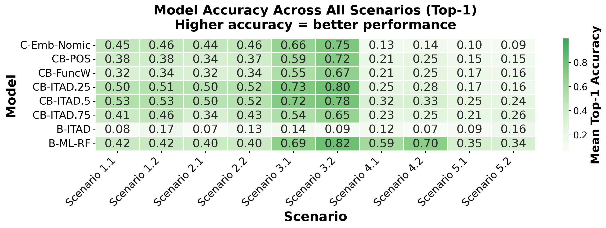
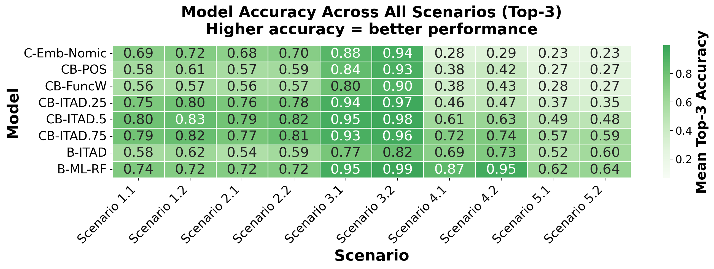
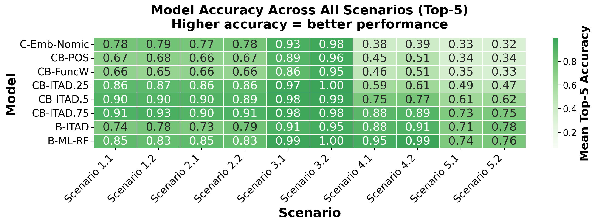

# Overall identity linkage performance

Created: 2026-09-20

This is Section IV-A of the paper and its Figure 2. The question:
across the ten gallery–probe configurations, how accurately does each identity
representation place the right person at the top of the ranking, and how does
that change when the platform, session or topic differs between the enrolled
data and the data to identify?

```bash
python plot_heatmaps.py     # a few seconds
```

It reads `../../experiments/results/scenario-results.csv` and writes
`accuracy_heatmap_k1.png`, `accuracy_heatmap_k3.png` and `accuracy_heatmap_k5.png`,
the three panels of Figure 2.

## The configurations

The columns of every heatmap are the ten configurations of Table II in the
paper. The paper also refers to them by a variation code; both are given here
because the text below uses the codes.

| Scenarios | Code | What is held fixed · what varies between gallery and probe |
|---|---|---|
| 1.1, 1.2 | PT·S | platform and topic fixed · the session differs (1.1 enrols session 1, 1.2 enrols session 2) |
| 2.1, 2.2 | T·PS | topic fixed · platform and session differ |
| 3.1, 3.2 | TS·P | topic fixed, both sessions pooled on each side · platform differs (3.2 enrols two platforms) |
| 4.1, 4.2 | S·PT | both sessions pooled · platform and topic differ (4.2 enrols two platforms) |
| 5.1, 5.2 | P·TS | platform fixed · topic and session differ |

Configurations 1.x, 2.x and 5.x have one observation per person on each side;
3.x and 4.x have two probe observations per person, which are treated as one
probe, and two or four enrolled observations per person.

## The figures





These three are the panels of Figure 2. A cell is the share of probes whose
correct identity was ranked in the top 1, 3 or 5 of the 61 enrolled people,
averaged over the platform–topic rotations that the configuration covers (9,
18 or 36 rotations; see `../../experiments/gallery-probe-configurations/`).
Darker is better. Reading across a row shows how one representation copes
with each kind of change; reading down a column shows which representations
do well under one kind of change.

Figure 4, which ranks the representations within every rotation, is drawn in
`../d-statistical-analysis/`, since the ranks are what the statistical tests
of Section IV-D use.

## What the results show

The text below is Section IV-A of the paper, with its statements checked
against the current results. The paper is being shortened, so this is the
fuller account.

Figure 2 summarizes the mean identification performance of all
representations across the ten experimental configurations. The three
heatmaps report ACC@1, ACC@3, and ACC@5. Rows correspond to the
representations in Table III, columns correspond to the gallery–probe
configurations in Table II, and each cell reports accuracy averaged across the
associated platform and topic rotations.

The results distinguish absolute identification accuracy from robustness under
contextual variation. Among all evaluated approaches, the Random Forest
keystroke-based representation (B-ML-RF) achieves the strongest performance in
every configuration in which the topic changes (S·PT and P·TS), whereas under
same-topic conditions the fusion representations are more accurate at ACC@1.
Under same-topic conditions (PT·S and T·PS), its ACC@1 ranges from
approximately 0.40 to 0.42, while under topic variation (P·TS) it falls to
0.34–0.35. ACC@5 decreases from approximately 0.83–0.85 to 0.74–0.76, a
smaller loss than for any text representation, indicating that topic variation
has a limited effect on its ability to rank the correct identity near the top
of the gallery.

The distribution-based keystroke representation (B-ITAD) exhibits a different
tradeoff. Although its ACC@1 is lower than that of several text and fusion
representations under same-topic conditions, its performance changes very
little when the topic varies. At ACC@5, performance ranges from approximately
0.73–0.79 under PT·S and T·PS, and from 0.71–0.78 under P·TS. Thus, while
B-ITAD is less accurate than B-ML-RF, its limited degradation indicates that
timing distributions encode an identity signal that is comparatively
insensitive to semantic context.

The text-based representations exhibit the opposite behavior. The raw
embedding representation (C-Emb-Nomic) performs best among the text models
when the gallery and probe share the same topic because semantic overlap
directly contributes to similarity. This advantage largely disappears under
topic variation, where ACC@1 falls to approximately 0.09–0.14. The POS
(CB-POS) and function-word (CB-FuncW) representations perform slightly better
under cross-topic conditions, reaching approximately 0.15–0.25 and 0.16–0.25,
respectively. Although these transformations reduce direct lexical overlap,
all three text representations remain substantially weaker when the
discussion topic changes.

The effect is even more apparent at higher ranks. For comparable gallery
sizes, C-Emb-Nomic decreases by approximately 0.35–0.37 at ACC@1 and by
0.44–0.47 at ACC@5 when moving from same-topic to cross-topic conditions. This
decline indicates that topic variation affects more than the ordering of
highly ranked candidates; it can move the correct identity well outside the
top-ranked portion of the gallery. Likewise, replacing lexical content with
POS tags or function words reduces, but does not eliminate, topic-dependent
linguistic structure.

The fusion representations occupy an intermediate position. Under same-topic
conditions, text-heavy fusion benefits from semantic overlap and achieves the
highest ACC@1. Under topic variation, however, representations assigning
greater weight to text experience substantially larger performance losses,
whereas keystroke-dominant fusion more consistently retains the correct
identity within the top-ranked candidates. Fusion therefore inherits the
contextual characteristics of its dominant modality rather than producing a
uniformly context-invariant representation.

Overall, Figure 2 shows that representation choice affects both absolute
identification accuracy and robustness to contextual variation. Platform and
session changes produce relatively small differences, whereas topic changes
create the clearest separation between text-based and keystroke-based
representations.
