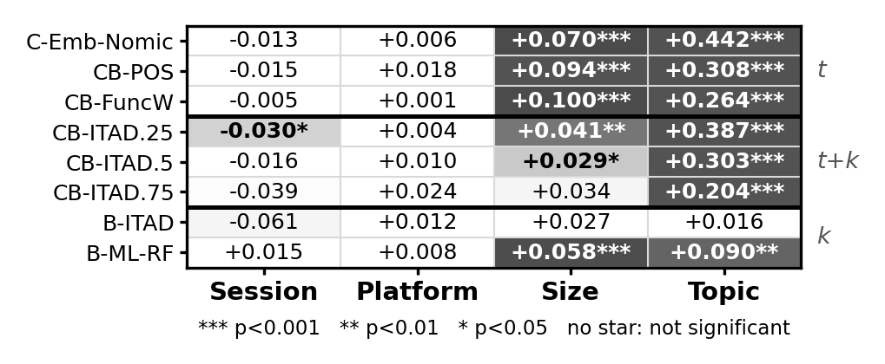
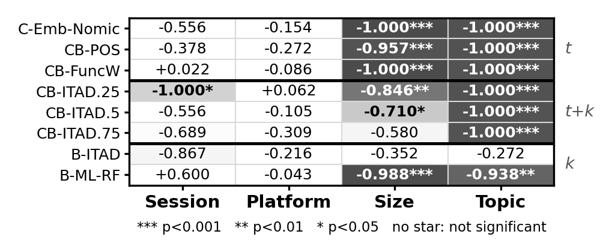

# Effect of contextual variation

Created: 2026-09-20
Updated: 2026-09-25

This is Section IV-B of the paper and its Figure 3. The question it answers:
when one thing changes between the enrolled data and the data to identify —
the session, the platform, the size of the gallery, or the discussion topic —
how much does each identity representation suffer, and is the change
statistically real?

```bash
python contextual_effects.py     # a few seconds
```

It reads `../../experiments/results/scenario-results.csv` and writes
`variable_effect_heatmap.pdf` (Figure 3, for the paper), `effect_size_heatmap.pdf`,
a PNG of each for this page, and `contextual_effects.csv`.

## The four comparisons

Each factor is isolated by comparing two gallery–probe configurations from
Table II of the paper that differ only in that factor. The paper writes the
configurations in its variation notation; the scenario numbers are the ones
used throughout this repo.

| Factor | Reference | Varied | What differs | Test |
|---|---|---|---|---|
| Session | 1.1 (PT·S) | 1.2 (PT·S) | the gallery and probe sessions are swapped | Wilcoxon signed-rank, paired by rotation |
| Platform | 1.1, 1.2 (PT·S) | 2.1, 2.2 (T·PS) | the probe comes from a different platform | Mann–Whitney U, two comparisons |
| Size | 3.2 (TS·P) | 3.1 (TS·P) | the gallery holds two platforms instead of one | Mann–Whitney U |
| Topic | 1.1, 1.2 (PT·S) | 5.1, 5.2 (P·TS) | the probe discusses a different topic | Mann–Whitney U, two comparisons |

The session comparison is paired because 1.1 and 1.2 use the same nine
platform–topic rotations; the others compare configurations with different
rotations, so they use an unpaired test. Where a factor has two comparisons,
the reported difference is the mean of the two and the reported p-value is
the smaller. All 32 p-values (eight representations × four factors) are
Bonferroni-corrected together, so a star means the result survived being one
of 32 tests.

## The measure

Each rotation is summarised by one number, the mean of its ACC@k over
k = 1…5, which the paper calls AUK. For a factor, the reported quantity is

    ΔAUK = mean AUK of the reference configuration − mean AUK of the varied one

so a positive ΔAUK means the varied condition did worse. **The size
comparison reads the other way round**: its reference is the larger gallery
(3.2), so a positive value means the larger gallery did *better*.

## The figures



This is Figure 3. The figure has no title; the paper's caption names it. Each
cell is ΔAUK for one representation (row) and one factor (column). Cells are shaded on one grey scale by their Bonferroni-corrected
p-value: white is not significant, and the darker the cell the smaller the
p-value, with the stars giving the level. One shade rather than the usual green
and red keeps the figure readable for colour-blind readers and in a
black-and-white print. The rows are grouped as in Table III:
text representations (*t*), score-level fusion (*t+k*) and keystroke
representations (*k*).



This plot is not in the paper. It shows the same 32 comparisons as a
rank-biserial correlation, which asks how consistently the rotations of one
configuration beat those of the other: −1 means every rotation of the varied
configuration scored below every rotation of the reference, +1 the reverse,
0 no tendency. Under topic change it reaches −1 for every text and fusion
representation because no cross-topic rotation comes anywhere near a
same-topic one; Figure 3 shows the same fact as a large ΔAUK. It is worth
looking at alongside Figure 3 because a small ΔAUK can still be perfectly
consistent (the session column for CB-ITAD.25) and a moderate one can be
mixed (the size column for the keystroke representations).

`contextual_effects.csv` holds the numbers behind both plots: one row per
representation and factor, with `delta_auk`, the corrected `p_corrected`,
`effect_size_r` and the star string.

## What the results show

The text below is Section IV-B of the paper, with its statements checked
against the current results. The paper is being shortened, so this is the
fuller account.

**Figure 3 summarizes the controlled contextual comparisons using ΔAUK.** For
each comparison, ΔAUK = AUK<sub>reference</sub> − AUK<sub>varied</sub>, where
AUK is the per-rotation measure described above. The reference configuration
represents the baseline condition, whereas the varied configuration introduces
the session, platform, gallery-size, or topic change under evaluation. Positive
values indicate lower performance under the varied condition, negative values
indicate improvement, and values near zero indicate little change. Statistical
tests were applied to the underlying rotation-level AUK measurements rather
than to the aggregated ΔAUK values shown in the figure. Cell shading indicates
the corresponding Bonferroni-corrected significance results.

**Session variation** is evaluated using the two PT·S configurations, which
reverse the gallery and probe sessions while holding platform and topic fixed.
Because these configurations differ only in session direction, they isolate
the effect of repeating the collection protocol. Across all representations,
ΔAUK values remain close to zero and are predominantly non-significant.
Figure 2 likewise shows little difference between the two PT·S configurations,
indicating that neither text-based nor keystroke-based representations change
systematically across sessions.

This stability is consistent with the experimental design. The repeated
sessions use the same platform and discussion topic, preserving substantial
linguistic similarity despite differences in wording, while keystroke-timing
characteristics remain stable across repeated observations. Consequently,
session contributes little to the observed degradation within the time span
represented by this dataset.

This conclusion should be interpreted within the scope of the study. The two
sessions represent repeated executions of the same controlled protocol rather
than observations separated by months or years. The results therefore support
short-term stability but do not establish long-term permanence.

**Platform variation** is evaluated by comparing the PT·S and T·PS
configurations, which preserve topic and session direction while introducing
a platform change between the gallery and probe. For most representations,
ΔAUK values remain small and statistically non-significant, and the ACC@K
heatmaps show nearly identical performance between the two configuration
groups. These findings indicate that changing the interface alone has little
effect when the discussion topic remains fixed.

This result reflects the controlled study design. Although real social-media
platforms differ in audience, editing behavior, message constraints, and
social conventions, the replicas used here standardized the commenting task
and minimum response length. Under these conditions, platform variation
contributes far less to linkage degradation than changes in discussion topic.
Keystroke-based representations exhibit similar stability, suggesting that
the interface differences among the three replicas do not substantially alter
the extracted timing features.

**Topic variation** is isolated by comparing the PT·S and P·TS configurations
with the same session direction. Both configurations include a session change
and hold platform constant, making discussion topic the only additional
factor. This comparison produces the clearest separation among the
representation families. Text representations exhibit large ΔAUK values and
strong statistical significance, whereas the keystroke-based representations
show substantially smaller changes. The ACC@K heatmaps reveal the same
pattern: text performance declines sharply under topic variation, while
B-ML-RF degrades only modestly (ΔAUK = 0.090) and B-ITAD shows no significant
change.

The raw embedding representation is particularly sensitive because it directly
encodes semantic content. Under matched-topic conditions, shared semantics
increase similarity between gallery and probe observations. When the topic
changes, this information no longer reflects identity and may instead increase
similarity between different users discussing the same subject, substantially
reducing identification performance.

The POS and function-word representations partially mitigate this effect by
suppressing lexical content and emphasizing structural characteristics. Their
modest improvement over raw embeddings under cross-topic conditions suggests
that reducing semantic overlap is beneficial, but the remaining degradation
demonstrates that topic influences more than content words. Sentence
organization, discourse structure, punctuation, function-word usage, and
grammatical patterns also vary with topic, and the contextual embedding model
continues to encode some of these effects. These representations should
therefore be viewed as topic-reduced rather than topic-independent.

Keystroke-based representations provide a useful contrast because they rely
on motor behavior rather than linguistic content. Their comparatively small
performance changes indicate that keystroke dynamics remain largely stable
across discussion topics. B-ML-RF combines the strongest cross-topic
discrimination with a small but significant topic effect, whereas B-ITAD
achieves lower absolute accuracy but shows no significant topic-induced
degradation.

These comparisons identify topic as the dominant contextual factor because it
changes the linguistic artifact itself, whereas platform and short-term
session changes primarily alter the conditions under which that artifact is
produced. Text-based representations therefore encode both identity-related
characteristics and topic-dependent information.

**Joint contextual variation.** The preceding analyses isolate the individual
effects of session, platform, and topic. The remaining configurations evaluate
more realistic scenarios in which multiple contextual factors vary
simultaneously or the gallery composition changes.

The T·PS configurations jointly vary platform and session while holding topic
fixed. Their performance remains similar to that of PT·S, indicating that
combining two individually weak contextual effects introduces little
additional degradation.

The TS·P configurations evaluate platform variation after pooling
observations across both sessions. Because one configuration also increases
gallery diversity and enrollment evidence, performance differences reflect
changes in both platform coverage and gallery composition rather than a
single contextual factor.

The S·PT configurations jointly vary platform and topic while pooling both
sessions, representing the strongest cross-context condition. Their
performance closely resembles that of the topic-changing P·TS configurations
rather than the platform-changing T·PS configurations. Text and text-heavy
fusion representations degrade substantially, whereas keystroke-based
representations remain comparatively stable, indicating that topic — not
platform — is the primary source of degradation.

Comparing S·PT with P·TS further reinforces this conclusion. Although one
combines topic with platform variation and the other with session variation,
both exhibit similar performance patterns. Once the discussion topic changes,
the additional platform or session shift contributes relatively little. The
impact of joint contextual variation is therefore governed primarily by the
extent to which a representation depends on topic-sensitive information.
