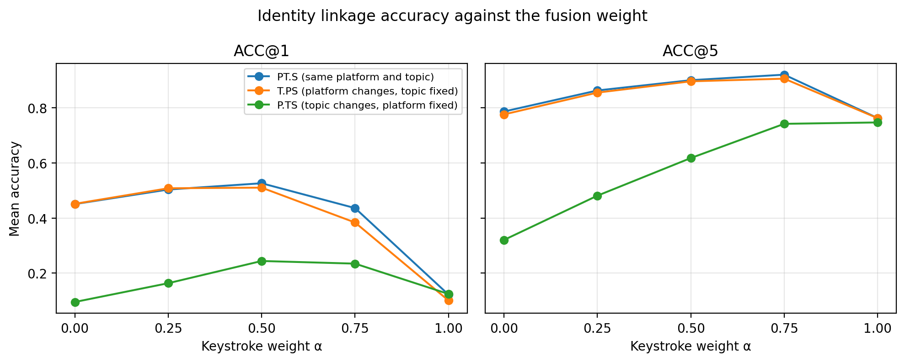

# Effect of multimodal fusion

Created: 2026-09-20

This is Section IV-C of the paper. The question: when a text score and a
keystroke score are combined into one, how does the weight given to the
keystroke side change accuracy — and does the answer depend on whether the
discussion topic is the same on both sides?

```bash
python fusion_weights.py     # a few seconds
```

It reads `../../experiments/results/scenario-results.csv` and writes
`fusion_weight_sweep.png` and `fusion_weights.csv`. The paper has no figure
for this section; the plot is the repo's own view of the numbers the text
quotes.

## The sweep

The three fusion representations combine, for every enrolled person and every
probe, the text similarity S<sub>t</sub> (cosine between Nomic embeddings)
and the keystroke similarity S<sub>k</sub> (ITAD) as

    S_f = α · S_k + (1 − α) · S_t

after each score table has been rescaled to 0–1 within the rotation
(`../../experiments/similarity-fusion/` explains). The two single-modality
representations sit at the ends of the same scale, so the five together form a
sweep over α:

| α | Representation | What it is |
|---|---|---|
| 0.00 | C-Emb-Nomic | text only |
| 0.25 | CB-ITAD.25 | text-heavy fusion |
| 0.50 | CB-ITAD.5 | equal weight |
| 0.75 | CB-ITAD.75 | keystroke-heavy fusion |
| 1.00 | B-ITAD | keystroke only |

Accuracy is shown for three groups of configurations, chosen so that the
first two keep the topic fixed and the third changes it:

| Group | Scenarios | What differs between gallery and probe |
|---|---|---|
| PT·S | 1.1, 1.2 | only the session |
| T·PS | 2.1, 2.2 | platform and session |
| P·TS | 5.1, 5.2 | topic and session |

## The figure



Each line is one group; each point is the mean accuracy over that group's
rotations at one value of α. Left is ACC@1, right is ACC@5. Two things to see:

- **Under a matched topic (blue and orange)** ACC@1 is highest at α = 0.25–0.5
  and falls off toward the keystroke-only end, while ACC@5 keeps rising to
  α = 0.75. Text is a strong signal when the topic is shared, and even a
  quarter weight of keystroke timing helps.
- **Under a topic change (green)** every fusion point is above both ends at
  ACC@5, and the curve rises steadily with α: the more the fused score leans
  on keystroke timing, the better it survives the topic change. At ACC@1 the
  curve is flat and low, because the text side has little to offer once the
  topic differs.

`fusion_weights.csv` has the numbers behind the plot: one row per
representation, group, scenario and k, with `keystroke_weight` and
`accuracy`.

## What the results show

The text below is Section IV-C of the paper, with its statements checked
against the current results. The paper is being shortened, so this is the
fuller account.

We evaluate the three score-level fusion configurations introduced in
Section III-D, which combine the text-embedding similarity S<sub>t</sub> and
the ITAD keystroke similarity S<sub>k</sub> according to Eq. 3. We consider
α ∈ {0.25, 0.50, 0.75}, where α denotes the weight assigned to the keystroke
score. Accordingly, CB-ITAD.25, CB-ITAD.50, and CB-ITAD.75 use keystroke
weights of 0.25, 0.50, and 0.75, respectively.

These configurations allow us to examine how modality weighting affects
robustness when a topic-sensitive text representation is combined with a
comparatively context-stable keystroke representation. Under same-topic
conditions, the text-heavy fusion models achieve the highest ACC@1. CB-ITAD.25
and CB-ITAD.50 reach approximately 0.50–0.53 across the PT·S and T·PS
configurations, whereas CB-ITAD.75 ranges from approximately 0.34 to 0.46. In
these configurations, semantic similarity provides a useful identity signal,
allowing stronger text weighting to improve first-rank identification despite
the lower ACC@1 of ITAD alone.

The trend changes at higher ranks and becomes more pronounced under topic
variation. For the same-topic configurations, CB-ITAD.75 achieves
approximately 0.90–0.93 at ACC@5, compared with approximately 0.86–0.87 for
CB-ITAD.25, indicating that keystroke-dominant fusion more consistently
retains the correct identity within the highest-ranked candidates.

Topic variation amplifies this difference. Although ACC@1 does not change
monotonically with fusion weight, ACC@5 improves consistently as the keystroke
contribution increases. Under P·TS, CB-ITAD.25 achieves approximately
0.47–0.49, CB-ITAD.50 improves to approximately 0.61–0.62, and CB-ITAD.75
further increases to approximately 0.73–0.75. The same trend appears in the
ΔAUK analysis, where degradation decreases from 0.387 to 0.303 and then to
0.204 as the keystroke weight increases. Because the three fusion models
differ only in their weighting, this ordered reduction demonstrates that the
context sensitivity of the fused representation is primarily inherited from
its text component.

These results also explain why multimodal fusion does not uniformly outperform
every unimodal representation. Fusion is beneficial only when both modalities
provide reliable evidence under the deployment conditions. Under matched-topic
conditions, semantic similarity improves identification accuracy by
complementing the weaker ITAD representation. Under topic variation, however,
the same semantic signal becomes less reliable and can shift the fused score
toward topic-similar rather than identity-similar candidates.

Nevertheless, the results demonstrate meaningful complementarity between the
two modalities. Although B-ITAD alone has relatively weak ACC@1, adding a
modest text contribution improves its ranking under same-topic conditions.
Conversely, keystroke-dominant fusion often outperforms B-ITAD under
cross-topic conditions despite the poor performance of the text representation
alone. A limited amount of textual information therefore remains useful when
constrained by a more stable keystroke signal.

Overall, the results show that no single fusion weight is optimal across all
contexts. Text-heavy fusion performs best when gallery and probe share the
same topic, whereas keystroke-dominant fusion provides greater robustness when
topics differ. These findings motivate context-aware fusion strategies that
adapt modality weights according to the expected reliability of each identity
signal rather than using a fixed weighting scheme.
