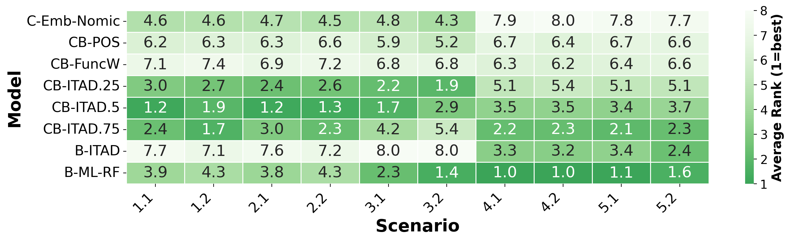

# Statistical analysis

Created: 2026-09-20
Updated: 2026-09-25

This is Section IV-D of the paper and its Figure 4. Two questions: are the
contextual effects of Section IV-B statistically real, and are the differences
between the eight representations more than chance?

```bash
python compare_representations.py     # a few seconds
```

It reads `../../experiments/results/scenario-results.csv` and writes
`rank_heatmap.pdf` (Figure 4, for the paper) and `rank_heatmap.png` (the same
figure, for this page), `friedman_results.csv`, `average_ranks.csv`
and one `nemenyi_<scenario>.csv` per configuration.

## The two analyses

**Contextual effects.** The tests behind Figure 3 — Wilcoxon signed-rank for
the session comparison, Mann–Whitney U for platform, gallery size and topic,
Bonferroni-corrected across all 32 comparisons — are computed in
`../b-contextual-variations/`, whose README explains them. Nothing here
recomputes them.

**Differences between representations.** Within one configuration every
representation is scored on the same platform–topic rotations, so the
rotations act as repeated measurements and the eight representations as the
treatments being compared. For each configuration:

1. Every rotation ranks the eight representations 1 to 8 by mean ACC@k over
   k = 1…5 (the per-rotation measure the paper calls AUK).
2. The **Friedman test** asks whether all eight perform equivalently across
   the rotations. Kendall's W, reported alongside, says how much the rotations
   agree on the ordering (0 none, 1 complete).
3. Where Friedman rejects, the **Nemenyi post hoc procedure** compares every
   pair of representations by their average ranks at α = 0.05. Two
   representations whose average ranks differ by less than the critical
   difference cannot be told apart; the critical difference depends only on
   the number of representations and rotations, so it is smaller in
   configurations with more rotations (1.75 for 36 rotations, 3.50 for 9).

## The figure



This is Figure 4. A cell is the average, over the rotations of the
configuration, of the rank the representation received in each rotation; 1.0
means it was best in every rotation. Darker is better. Ranks are relative, so
when one representation moves, the others move with it, and a difference
between two cells in a column is only meaningful if it exceeds that
configuration's critical difference.

## The files

| File | Contents |
|---|---|
| `friedman_results.csv` | one row per configuration: number of rotations, Friedman χ², p-value, Kendall's W, whether p < 0.05, and the Nemenyi critical difference |
| `average_ranks.csv` | the numbers in Figure 4 |
| `nemenyi_<scenario>.csv` | 8 × 8 table of Nemenyi p-values for that configuration |

The critical-difference diagrams in `../extra-plots/` show the same Nemenyi
results graphically, one per configuration.

## What the results show

The text below is Section IV-D of the paper, with its statements checked
against the current results. The paper is being shortened, so this is the
fuller account.

We conducted two complementary statistical analyses. First, the effect of each
controlled variation was evaluated separately for every identity
representation using the underlying rotation-level AUK measurements.

Session effects were evaluated using paired comparisons because the
corresponding AUK measurements could be matched by platform–topic rotation
across the two session directions. Platform, gallery-size, and topic effects
were evaluated using independent comparisons because the corresponding
configurations did not produce directly matched sets of rotation-level
measurements. Accordingly, the Wilcoxon signed-rank test was used for the
session comparison, whereas the Mann–Whitney U test was used for the platform,
gallery-size, and topic comparisons. The Bonferroni correction was applied
jointly across the 32 contextual comparisons shown in Fig. 3, corresponding to
eight identity representations evaluated under four contextual factors. The
family-wise significance threshold was therefore α<sub>corr</sub> = 0.05/32 ≈
0.00156.

Second, differences among the identity representations were assessed using
the Friedman test over the repeated experimental conditions. When the omnibus
test was significant, the Nemenyi post hoc procedure was used to compare the
average ranks of the representations at α = 0.05.

**Statistical evidence for contextual effects.** The significance results in
Fig. 3 support the descriptive patterns reported above. Session and platform
comparisons yield small ΔAUK values and are predominantly non-significant.
Topic variation, in contrast, produces significant degradation for the
text-based representations and for fusion methods with greater text weight.
The keystroke-based representations exhibit smaller changes. These results
confirm that sensitivity to topic depends on the underlying identity modality
rather than reflecting a uniform increase in task difficulty.

**Comparison across identity representations.** Figure 4 summarizes the
average rank of each representation across all experimental configurations,
where lower values indicate stronger overall performance.

The Friedman test rejects the null hypothesis that all representations perform
equivalently across the evaluated configurations (p < 0.05), indicating that
the observed differences are unlikely to result from random variation.
Pairwise differences are subsequently examined using the Nemenyi post hoc
procedure at α = 0.05.

CB-ITAD.50 and B-ML-RF share the strongest overall ranking, with average ranks
of 2.4 and 2.5, but they earn it in different places: the fusion
representations lead under same-topic conditions, whereas B-ML-RF ranks first
in every configuration in which the topic changes. The Nemenyi procedure
separates the two in the T·PS configurations, where CB-ITAD.50 ranks higher,
and in the S·PT configurations, where B-ML-RF does. B-ML-RF is thus the
representation whose standing depends least on the discussion topic.

The remaining representations exhibit greater context dependence. Although
B-ITAD ranks lower under same-topic conditions because of its comparatively
weak ACC@1, its relative standing improves when the discussion topic changes
because its performance degrades far less than that of the text
representations. Conversely, C-Emb-Nomic benefits substantially from semantic
overlap under matched-topic conditions but drops markedly under cross-topic
evaluation. This contrast illustrates that high average accuracy under
favorable conditions does not necessarily imply robustness to contextual
variation.

The POS and function-word representations generally rank below the strongest
keystroke-based and fusion approaches. Although suppressing lexical content
reduces semantic dependence, the resulting representations do not recover
sufficient author-specific information to compensate for the loss of lexical
evidence.

The fusion representations' rankings reflect the balance between text and
keystroke contributions. Keystroke-dominant fusion performs more consistently
under topic variation, whereas text-heavy fusion benefits primarily from
matched-topic conditions. These rankings therefore reinforce the ACC@K and
ΔAUK analyses while emphasizing two complementary observations: the choice of
matching algorithm influences absolute identification accuracy, whereas the
choice of identity modality largely determines robustness to contextual
change.

Overall, the ranking analysis identifies B-ML-RF as the strongest method under
topic change and score-level fusion as the strongest under matched-topic
conditions, and shows that the relative performance of the remaining
representations depends strongly on topic compatibility and fusion weighting.
