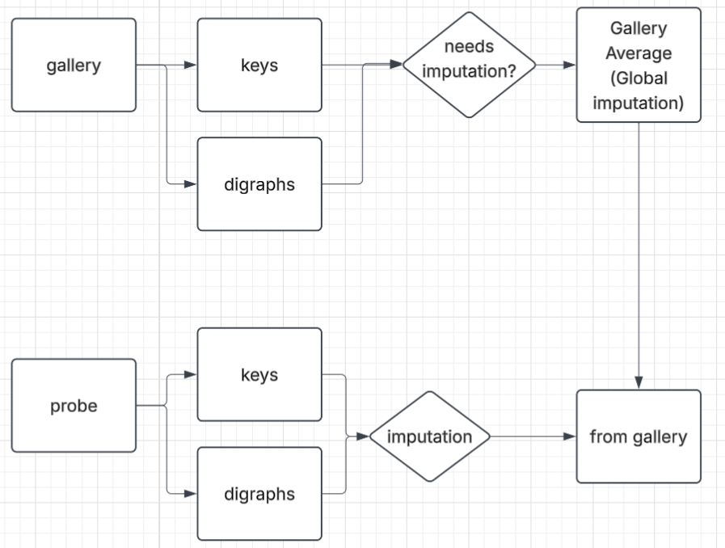

# Keystroke-based representations

Created: 2026-09-20
Updated: 2026-09-20

Identity signals taken from how the text was typed rather than what it says.

| Representation | Script | Status |
|---|---|---|
| `B-ML-RF` | `random_forest.py` | in place; results in `../results/B-ML-RF.tsv` |
| `B-ITAD` | — | to be added |

## Vocabulary used below

**Sample.** One participant's typed response on one platform, about one topic,
in one session. There are 1,098: 61 participants × 3 platforms × 3 topics × 2
sessions.

**Rotation.** Each scenario in the paper is a family of experiments, not a
single one. Scenario 1.1 says "same platform, same topic, session 1 enrolled,
session 2 as the probe", and that describes nine separate experiments —
Facebook / topic 1, Facebook / topic 2, and so on. Each one is a rotation. The
ten scenarios contain 171 rotations in total, listed in
`../gallery-probe-configurations/scenarios.csv`.

**Gallery and probe.** The gallery is the enrolled data: we know whose each
sample is. The probe is the data to identify: we do not. Within a rotation no
sample is on both sides, and both sides contain all 61 participants.

**Column.** One number the classifier sees: one statistic (say, the median) of
one timing (say, hold latency) for one key or one pair of keys. A key
contributes 5 columns; a pair of keys contributes 20.

**Empty cell.** If a participant never typed a key in a given sample, no
statistic exists for it in that sample, and that cell is empty.

## Running it

```bash
python features.py        # keypairs -> features.parquet, about a minute
python random_forest.py   # 171 rotations x 3 seeds -> ../results/B-ML-RF.tsv
```

With no options, this produces the results in this repository and writes them
to `../results/B-ML-RF.tsv`. `features.py` needs rerunning only if the feature
definition changes.

## The features

Everything starts from `datasets/clean-data/dataset/keypairs/keypairs.parquet`,
which has one row per pair of consecutive keys with the press and release time
of each. Nothing averaged or filled in upstream is used; every timing is
recomputed here from those four timestamps.

| Timing | Definition |
|---|---|
| Hold latency | key press to release of the same key |
| Press to press | press of the first key to press of the second |
| Release to press | release of the first key to press of the second |
| Release to release | release of the first key to release of the second |
| Press to release | press of the first key to release of the second |

For every key and every kept pair of keys, five statistics are recorded per
sample: median, mean, standard deviation, first quartile, third quartile.

By default all 85 keys seen in the data are kept, along with the ten pairs of
keys that appear in the most samples. That is the feature set the paper used:
85 × 5 + 10 × 20 = 625 columns. Because a response of 150 or so characters
contains only some of the 85 keys, 68% of the hold-latency cells are empty and
47% of all cells are.

`features.py --key-coverage 0.9` instead keeps only the 20 keys present in at
least 90% of samples (300 columns, 2.8% empty). It was tried and scores
slightly lower, so the paper's set is kept.

## Filling empty cells

A Random Forest cannot accept an empty cell, so every one must be given a
number. The number used is the only thing that distinguishes the results here
from the ones the paper reported, so this section is longer than it looks like
it should be.

### The rule used



For each rotation, and for each column, take the average over the gallery
samples that contain that key or pair of keys. Put that one number into every
empty cell of that column — in gallery samples and in probe samples alike.

Three things follow from the picture:

- The number comes from the enrolled data only. It never depends on whose
  sample it goes into, so it cannot carry identity.
- Gallery and probe are filled from the same source, so the classifier is
  tested on the same kind of input it was trained on.
- A column whose key appears in no gallery sample at all has no average to
  take; it is set to zero on both sides, and the classifier ignores it.

### Why this rule

What may legitimately fill a cell depends on which side it is on:

| Where the number comes from | For a gallery sample | For a probe sample |
|---|---|---|
| That participant's own average | Justified — we know who they are | **Not justified** — it assumes the answer |
| An average over the gallery | Justified | Justified — it is all that is available |

Two further points decide it.

**Both sides must be filled the same way.** Filling gallery samples from each
person's own other samples and probes from the gallery average is defensible
rule by rule, and it was tried. It loses, and it loses more the more cells are
filled. The reason is that where a cell is empty on both sides, the gallery
copy then holds a person-specific value and the probe copy a shared constant,
so the classifier learns rules no probe can satisfy. The telltale result is
more enrolment data making accuracy *worse*, and it appears only in scenarios
3.1, 3.2, 4.1 and 4.2 — the only ones where a participant has more than one
gallery sample to average.

**The rule the paper's results were produced with is not legitimate.** Every
cell, gallery and probe alike, was filled from that participant's average over
all 18 of their samples. For a probe that uses the identity the experiment is
trying to predict. With 47% of cells filled that way, two samples from the
same person share identical values in nearly half their columns, and that —
not the typing — is most of what the classifier learned. It can still be run:

```bash
python random_forest.py --imputation dataset
```

### What each rule gives

Mean ACC@1 over the ten scenarios, all on the paper's feature set, with each
probe sample scored on its own (`--probe separate`, so the rules are compared
on the same footing as the published run):

| Rule | Mean ACC@1 |
|---|---|
| Gallery average, both sides — **the rule used** | **0.488** |
| The sample's own other keys, both sides (`--imputation self`) | 0.471 |
| Person's own gallery samples for the gallery, gallery average for the probe | 0.419 |
| Person's average over all 18 samples, both sides (`--imputation dataset`, as published) | 0.882 |

Other legitimate variants — the 20-key feature set, or choosing features
afresh from each gallery (`random_forest_intersection.py`) — all land between
0.43 and 0.47. That agreement across quite different treatments is the
strongest evidence that about 0.49 is what the keystroke timings support.
With a person's two probe samples in 3.x/4.x scored as one probe, as the
results table now does, the rule used gives 0.51.

### `random_forest_intersection.py`

Kept for comparison. For each rotation it keeps only the columns whose key or
pair was produced in at least a given share of that rotation's gallery samples
(`--present-in`, default 1.0), so that at 1.0 nothing is filled on the gallery
side. It reads `features.parquet`, scores 0.469 at 1.0 and lower at every
looser threshold, so it is not the rule used. Its docstring describes it in full.

## Classifier

A Random Forest with one class per enrolled participant, fitted on the gallery
and scored on the probes with `predict_proba`. Identities are ranked by that
score and ACC@k records whether the correct one is among the top k.

Settings are held fixed across every rotation: 500 trees, unrestricted depth,
square-root feature sampling, balanced class weights. Every participant
contributes the same number of gallery samples, so the classes are balanced by
construction and the class weighting has no effect; it is set only to make
that explicit.

Each rotation is run with three seeds — 42, 123 and 456 — and the five ACC@k
values are the mean over the three runs.

**Probes of two sessions.** In scenarios 3.1, 3.2, 4.1 and 4.2 each person has
two probe samples. They are treated as one probe of that person: the forest
scores both, the class probabilities are averaged, and the identities are
ranked once. That is the same treatment the other representations give a
person's probe samples, which they pool before scoring, and it is symmetric
with the gallery side, where every enrolled sample of a person trains that
person's class. `--probe separate` scores each probe sample on its own
instead; only those four scenarios change, and they come out lower (ACC@1
0.61–0.76 rather than 0.69–0.82 in 3.x).
